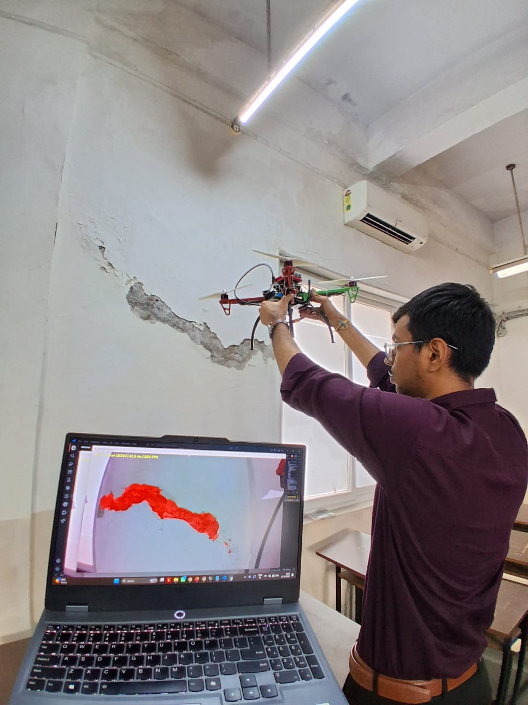

# Phase 3 — SegFormer

[Project overview](../README.md) · [Getting started](../docs/getting-started.md)

This phase covers transformer-based crack segmentation with SegFormer. The team trained and tested B0, B1 and B2, then carried B2 forward into deployment experiments. Training and evaluation run on a training computer; deployment inference runs on the ground-station laptop.

| Folder | Role |
|---|---|
| [training](training/README.md) | Training workflows for dataset preparation, optimisation and checkpoint saving |
| [datasets](datasets/README.md) | Kaggle sources, pairing and split guidance |
| [evaluation](evaluation/README.md) | Evaluation procedure and available evidence |
| [walkthroughs](walkthroughs/README.md) | Load trained B0/B1/B2 checkpoints and explain predictions; no training loop |
| [inference](inference/README.md) | Offline video-to-mask scripts |
| [model-packaging](model-packaging/README.md) | FP32/FP16/experimental INT8 export and comparison |
| [checkpoints](checkpoints/README.md) | Required checkpoint schemas and placement |
| [experiments](experiments/README.md) | Learning notes, generic tester and incomplete Pi watcher |
| `legacy/previous-repository/` | Original repository script versions retained for provenance |

## Camera-based inference demonstration

*Handheld camera testing with segmentation on the laptop. The predicted overlay illustrates deployment behaviour; quantitative model performance is reported separately.*

**Dashboard panels:** **Raw** (left) shows the original camera frame; **Processed** (right) shows the predicted crack segmentation overlay.

## Environment

Create a dedicated virtual environment. Install a compatible PyTorch/CUDA build using [the official selector](https://pytorch.org/get-started/locally/), then install `03-segformer/requirements.txt`. Requirements list imported dependencies, not a fully reproduced lockfile. Keep the TensorFlow and Pi environments separate. For full-model checkpoint loading, retain the producing PyTorch/Transformers environment when possible.

## Model development sequence

1. Download the [datasets](datasets/README.md) and inspect image/mask pairing.
2. Run the [training notebooks](training/README.md) with explicit model and data settings.
3. Record a split manifest, checkpoint identity and validation-selected threshold; evaluate a held-out test set.
4. Use the model-specific walkthrough to inspect masks.
5. Run offline video inference, then export a compatible deployment package.
6. Continue with [live implementation](../04-live-implementation/README.md).

The current source has historical threshold and checkpoint differences. Use the metadata for the exact checkpoint being loaded; do not mix a reported test threshold with an unrelated live checkpoint. [Recorded results](../docs/results-and-limitations.md).
