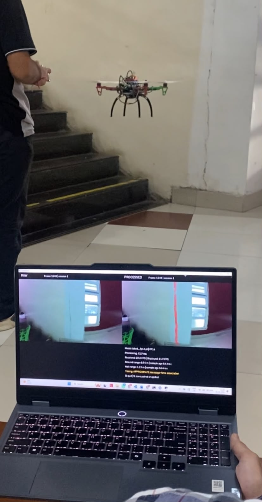

# Phase 4 — Live drone-to-laptop crack segmentation

[Project overview](../README.md) · [Getting started](../docs/getting-started.md)

This phase combines the trained model with live camera and sensor data. The Raspberry Pi captures and transmits video and telemetry, while the laptop decodes frames, associates distance readings, runs SegFormer and displays the results. Pixhawk provides flight control and the lidar interface.

Start with [the ordered startup guide](docs/startup-sequence.md). Prerequisites are working Pi camera and dual-lidar tests, a shared network, compatible MediaMTX, a CUDA laptop and a trusted trained model package. The reception probe and preview do not require a model; the final inference path does require CUDA.

| Folder/file | Executes on | Role |
|---|---|---|
| `raspberry-pi/phase4.yml` | Pi MediaMTX | IMX219 H.264 RTSP stream |
| `raspberry-pi/pi_telemetry_sender.py` | Pi | Sole Pixhawk reader, TIMESYNC and UDP sender |
| `ground-station/laptop_dashboard.py` | Laptop | Probe, preview, inference, display and outputs |
| `ground-station/rtsp_video.py` | Laptop | RTSP/TCP reception, RTP/RTCP timing, PyAV decoding |
| `ground-station/model.py` | Laptop | SegFormer preprocessing, FP16/FP32 inference and masks |
| `shared/timing.py` | Both | Timing maps, packet validation and matching utilities |
| `shared/telemetry_common.py` | Both | Packet and range utilities |
| `tests/` | Development laptop | Software tests; no flight hardware |
| `benchmarks/` | Laptop | Historical FP32/FP16 benchmark |
| `legacy/` | Varies by prototype | Earlier stream, inference and telemetry implementations |

Keep this phase folder intact on both devices: entrypoints resolve sibling `shared/` modules relative to their own files. Copying only the sender is insufficient. Run documented commands from this phase root; checkpoint paths are relative to your working directory unless absolute.

## Live demonstration



*Flight demonstration with the original camera image and predicted crack overlay displayed on the ground-station laptop.*

[Watch the animated demonstrations](../docs/flight-demonstrations.md) · [Handheld and flight photo gallery](../docs/project-gallery.md)

## Dashboard outputs

The dashboard pairs the same raw frame and processed overlay with frame IDs, inference timing, FPS, ranges and timing status. `--record` enables video output; `S` saves a snapshot and `Q` exits. Metadata and summaries are written under `phase4_results/` unless `--output` changes it.

Matching is approximate message-time association. A working probe does not certify exposure-to-lidar acquisition alignment. Read [timing](docs/timing-and-sensor-association.md), [troubleshooting](docs/troubleshooting.md), and [recorded results](../docs/results-and-limitations.md).

## Software checks

From the repository root, with NumPy, PyAV and OpenCV installed:

```bash
python -m unittest discover -s 04-live-implementation/tests -v
```

Core tests cover timing, packets and sample selection. A sender test uses a deterministic MAVLink transport double. Integration uses real local sockets and H.264 encode/decode, tests recording and reconnection, and requires PyAV's encoder support. This does not test Pi camera, firmware, flight, CUDA checkpoint loading or physical latency.
