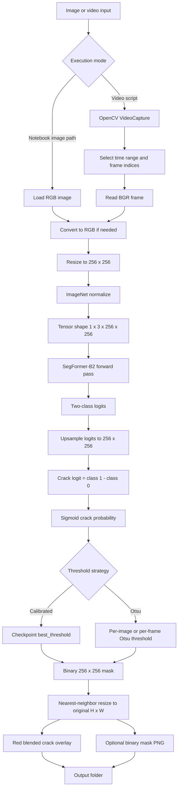
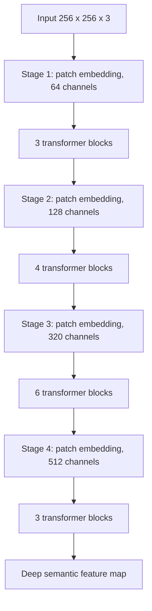
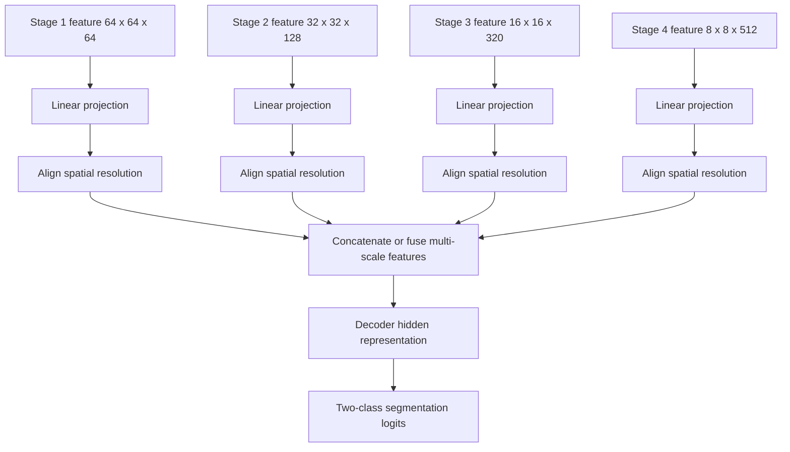
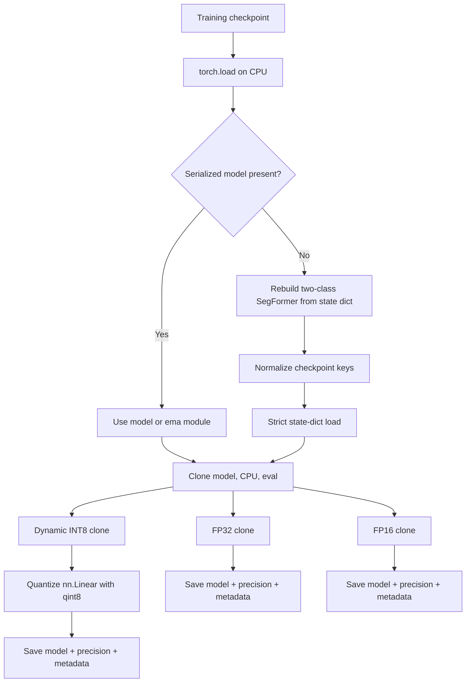

# CrackSense B2 Project Architecture and Workflow Report

## 1. Report Scope

This report documents the project as it exists in the repository: a PyTorch and Hugging Face SegFormer-B2 semantic-segmentation system for detecting surface cracks in images and sampled video frames.

The report covers:

- repository artifacts and responsibilities;
- image and video inference workflows;
- MiT-B2 transformer encoder and SegFormer decoder architecture;
- checkpoint loading and state-dictionary compatibility mapping;
- mask generation, thresholding, resizing, and overlays;
- test-time augmentation (TTA);
- FP32, FP16, and dynamic INT8 packaging;
- quantized-model verification and benchmarking;
- reproducibility observations and implementation risks.

### Evidence status

The architecture and workflows below are derived from the checked-in Python scripts and notebook source. Both notebooks are marked as unexecuted in their current metadata, even though they contain saved output representations. The checked-in training checkpoints were not runtime-verifiable during this inspection: PyTorch reported `PytorchStreamReader failed reading zip archive: unsupported multidisk archive` while loading a checkpoint. Therefore, claims about the intended model are source-grounded, while claims about the current binary checkpoint contents remain pending checkpoint repair.

## 2. Executive Summary

CrackSense is a two-class semantic segmentation pipeline:

1. Read an image or sample frames from a video.
2. Convert OpenCV BGR data to RGB.
3. Resize the image to `256 x 256` for the main inference paths.
4. Apply ImageNet normalization and convert the image to a PyTorch tensor.
5. Run a Hugging Face `SegformerForSemanticSegmentation` model configured as `nvidia/mit-b2` with two labels: `background` and `crack`.
6. Convert the two output logits into a single crack logit.
7. Apply sigmoid to obtain a crack probability map.
8. Threshold the probability map into a binary mask.
9. Resize the mask back to the original frame or image resolution with nearest-neighbor interpolation.
10. Save a red crack overlay, and in the newer video pipeline also save the binary mask and CSV metadata.

The model is a transformer-based encoder plus lightweight multi-scale SegFormer decoder. The encoder progressively reduces spatial resolution while increasing feature width. The decoder combines multi-scale features and produces two-class segmentation logits.

## 3. Repository Inventory

| Artifact | Responsibility | Operational role |
|---|---|---|
| [CrackSense_Explained_B2.ipynb](CrackSense_Explained_B2.ipynb) | Single-image model explanation | Shows preprocessing, encoder stages, logits, thresholding, and visualization |
| [CrackSense_Explained_B2_OriginalResolutionMasks.ipynb](CrackSense_Explained_B2_OriginalResolutionMasks.ipynb) | Extended explanation and original-resolution masks | Adds original-resolution mask handling and TTA demonstration |
| [crack_video_inference.py](crack_video_inference.py) | Earlier video inference path | Samples by timestamp/FPS; calibrated or Otsu threshold; saves overlays |
| [extract_frames_with_crack_detection.py](extract_frames_with_crack_detection.py) | Earlier frame extraction path | Similar video pipeline with calibrated/Otsu threshold selection |
| [extract_frames_with_crack_detection_2.py](extract_frames_with_crack_detection_2.py) | Newer video inference path | Supports packaged quantized models, exact frame count, deterministic index sampling, TTA, masks, and CSV output |
| [quantize_segformer.py](quantize_segformer.py) | Checkpoint conversion | Produces FP32, FP16, and dynamic INT8 inference packages |
| [Verify_quantised.py](Verify_quantised.py) | Model package inspection | Checks sizes, parameter dtypes, modules, state dict, NaN/INF, and forward pass |
| [compare_videos.py](compare_videos.py) | Performance benchmark | Compares FP32 GPU, FP16 GPU, and INT8 CPU inference latency/FPS |
| `checkpoints/` | Training checkpoints | Contains `best.pt` and `latest.pt`; expected to contain `model_state_dict` and training metadata |
| `Quantised/` | Inference packages | Contains `latest_fp32.pt`, `latest_fp16.pt`, and `latest_int8.pt` |
| `output/` | Generated results | Contains numbered output folders created by video inference |
| `Crack_video.mp4`, `test_video.mp4` | Input media | Local video sources for inference and benchmarking |
| `WhatsApp Image 2026-08-17 at 22.19.55.jpeg` | Example image | Notebook single-image input |

## 4. End-to-End System Flow



## 5. Main Inference Workflow

### 5.1 Checkpoint discovery and loading

The scripts support two checkpoint families:

1. **Training checkpoint:** a dictionary containing `model_state_dict`, training metadata such as `epoch`, `best_dice`, `best_threshold`, and `config`.
2. **Packaged inference checkpoint:** a dictionary containing a ready-to-run serialized `model`, `precision`, and `checkpoint_metadata`.

The newer script searches relative to the script directory in this order:

1. `Quantised/latest_fp32.pt`
2. `Quantised/latest_fp16.pt`
3. `Quantised/latest_int8.pt`
4. `checkpoints/latest.pt`
5. `checkpoints/best.pt`

For a training checkpoint, the script constructs the Hugging Face SegFormer model, normalizes training key names, and loads the state dictionary. For a packaged model, it uses the serialized model directly.

### 5.2 Checkpoint key normalization

The project contains a compatibility layer between training-style names and Hugging Face names. It performs these transformations:

| Training key pattern | Hugging Face target |
|---|---|
| `segformer.stages.N.patch_embeddings.` | `segformer.encoder.patch_embeddings.N.` |
| `segformer.stages.N.blocks.M.` | `segformer.encoder.block.N.M.` |
| `segformer.stages.N.layer_norm.` | `segformer.encoder.layer_norm.N.` |
| `.layernorm_before.` | `.layer_norm_1.` |
| `.layernorm_after.` | `.layer_norm_2.` |
| `.attention.q_proj.` | `.attention.self.query.` |
| `.attention.k_proj.` | `.attention.self.key.` |
| `.attention.v_proj.` | `.attention.self.value.` |
| `.attention.o_proj.` | `.attention.output.dense.` |
| `.attention.sequence_reduction.sequence_reduction.` | `.attention.self.sr.` |
| `.attention.sequence_reduction.layer_norm.` | `.attention.self.layer_norm.` |
| `.mlp.fc1.` | `.mlp.dense1.` |
| `.mlp.fc2.` | `.mlp.dense2.` |
| `decode_head.linear_projections.` | `decode_head.linear_c.` |

This mapping is repeated in multiple scripts and notebooks, so it is a shared compatibility contract even though it is not currently centralized in a module.

### 5.3 Image preprocessing

The main inference and notebook paths use:

```text
Original image/frame
    -> RGB ordering
    -> Resize(256, 256)
    -> divide by 255 and ImageNet normalize
       mean = (0.485, 0.456, 0.406)
       std  = (0.229, 0.224, 0.225)
    -> ToTensorV2
    -> batch dimension
    -> 1 x 3 x 256 x 256
```

The encoder is ImageNet-pretrained, so matching the normalization used during pretraining is required for consistent feature activations.

### 5.4 Segmentation output conversion

The model produces two class logits. The project derives one crack score with:

$$
z_{crack} = z_{class\ 1} - z_{class\ 0}
$$

Then it computes:

$$
p_{crack} = \sigma(z_{crack})
$$

The result is a `256 x 256` probability map. The standard scripts use bilinear interpolation for logits before the binary conversion. The final binary mask uses nearest-neighbor interpolation when restored to the original resolution so mask values remain discrete.

### 5.5 Overlay generation

Crack pixels are painted red in BGR format as `[0, 0, 255]`. The red-highlighted image and original image are blended with weights `0.40` and `0.60`, respectively. The original frame dimensions are preserved in the final overlay.

## 6. Transformer and SegFormer Architecture

### 6.1 High-level architecture

```mermaid
flowchart LR
    A[3-channel 256 x 256 image] --> B[Patch embedding stage 1]
    B --> C[MiT-B2 transformer blocks]
    C --> D[Patch embedding stage 2]
    D --> E[MiT-B2 transformer blocks]
    E --> F[Patch embedding stage 3]
    F --> G[MiT-B2 transformer blocks]
    G --> H[Patch embedding stage 4]
    H --> I[MiT-B2 transformer blocks]
    B -. multi-scale feature 1 .-> M[SegFormer decode head]
    D -. multi-scale feature 2 .-> M
    F -. multi-scale feature 3 .-> M
    I -. multi-scale feature 4 .-> M
    M --> N[Linear projections]
    N --> O[Feature resize and fusion]
    O --> P[Two-class segmentation logits]
```



The model is instantiated as `SegformerForSemanticSegmentation` with the pretrained backbone identifier `nvidia/mit-b2`, then configured for two labels. The precise low-level forward implementation is supplied by the installed Hugging Face Transformers version; the repository explicitly confirms the model family, head configuration, and checkpoint key structure.

### 6.2 MiT-B2 encoder configuration

The project’s quantization reconstruction code records the following architecture configuration:

| Encoder stage | Approx. feature map for 256 input | Hidden channels | Transformer blocks | Attention heads | Spatial reduction ratio | MLP ratio |
|---:|---:|---:|---:|---:|---:|---:|
| 1 | 64 x 64 | 64 | 3 | 1 | 8 | 4 |
| 2 | 32 x 32 | 128 | 4 | 2 | 4 | 4 |
| 3 | 16 x 16 | 320 | 6 | 5 | 2 | 4 |
| 4 | 8 x 8 | 512 | 3 | 8 | 1 | 4 |

The architecture follows the hierarchical vision-transformer pattern:



### 6.3 One MiT transformer block

The key names in the repository expose the constituent operations:


The attention path contains query, key, value, output projection, and a spatial-reduction operator. Spatial reduction lowers the key/value sequence cost at early high-resolution stages; the configured ratios are `8, 4, 2, 1` from shallowest to deepest stage.

The MLP path expands each stage’s hidden width by the configured ratio of `4`, applies the block activation, and projects back to the stage width. Layer normalization and residual connections preserve optimization and information flow.

### 6.4 SegFormer decoder

The four encoder outputs are sent to the decode head through per-stage linear projections. The project’s checkpoint conversion maps training names from `decode_head.linear_projections` to Hugging Face’s `decode_head.linear_c`, confirming the multi-scale linear projection path.

Conceptually, the decoder performs:



The project explicitly sets `decoder_hidden_size=768` when reconstructing the model from a state dictionary. The inference scripts then interpolate the decoder logits to `256 x 256` before converting them to a crack mask.

## 7. Video Workflow Variants

### 7.1 `crack_video_inference.py`

This path:

- requires `--video`;
- defaults to `2.0` processed frames per second;
- supports `--start`, `--end`, and `--max-frames`;
- searches for a training checkpoint using working-directory-relative candidates;
- loads the architecture and `model_state_dict`;
- reads `best_threshold` from checkpoint metadata;
- supports `calibrated` or per-frame `otsu` thresholding;
- creates a new numbered output folder;
- resizes masks to the source frame resolution;
- saves blended crack overlays.

### 7.2 `extract_frames_with_crack_detection.py`

This is a closely related earlier implementation. It follows the same preprocessing, two-class logit conversion, mask resizing, and overlay behavior. Its checkpoint discovery is also working-directory-relative.

### 7.3 `extract_frames_with_crack_detection_2.py`

This is the more complete production-style path. It adds:

- packaged-model loading for `Quantised/*.pt` files;
- script-directory-relative checkpoint discovery;
- exact frame-count sampling with `--num-frames`;
- deterministic source-frame index selection using `numpy.linspace`;
- optional TTA using `--tta`;
- Otsu thresholding after normal or TTA prediction;
- original-resolution binary mask PNG output;
- CSV metadata for processed frames.

Its sampling modes are:

```mermaid
flowchart TD
    A[Video metadata] --> B[Compute start and end frame]
    B --> C{--num-frames supplied?}
    C -->|Yes| D[Evenly spaced indices with linspace]
    C -->|No| E[Frame step = round(source FPS / requested FPS)]
    D --> F[Read selected source frames]
    E --> F
    F --> G{--tta?}
    G -->|No| H[One model pass]
    G -->|Yes| I[Five model passes and probability average]
    H --> J[Otsu threshold]
    I --> J
    J --> K[Original-resolution mask and overlay]
    K --> L[Image files and CSV metadata]
```

## 8. Test-Time Augmentation

The newer script and original-resolution notebook implement five predictions per input:

1. original image;
2. horizontal flip, then reverse the probability map horizontally;
3. vertical flip, then reverse the probability map vertically;
4. centered scale-up to `1.25x` and crop back;
5. centered scale-down to `0.75x` and zero-pad back.

The five probability maps are averaged before thresholding. TTA increases model calls from one to five per frame, so it is an accuracy/stability option with an approximately fivefold model-inference cost before other overheads.

## 9. Thresholding and Mask Semantics

### Calibrated threshold

The calibrated mode uses `best_threshold` saved in the training checkpoint, defaulting to `0.50` when the metadata is absent. This gives a stable threshold across frames and is the preferred mode when the validation calibration is trustworthy.

### Otsu threshold

The Otsu mode maps probabilities from `[0, 1]` to `[0, 255]`, computes an image-specific histogram threshold, converts that threshold back to `[0, 1]`, and marks pixels satisfying `probability > threshold` as crack pixels.

Otsu can adapt to changing image contrast but may produce frame-to-frame threshold variation. In the newer pipeline, Otsu is always used after optional TTA.

### Output semantics

The binary mask uses `0` for background and `1` for crack. The mask is resized with `INTER_NEAREST`, and the overlay marks mask pixels in red while retaining the original dimensions.

## 10. Quantization and Packaging Workflow



`quantize_segformer.py` intentionally keeps convolution layers in FP32 while applying dynamic INT8 quantization to `nn.Linear` layers. This is suited to the transformer-heavy MiT blocks, whose attention and MLP paths contain many linear layers. Dynamic quantization stores linear weights as INT8 and quantizes activations at runtime.

The generated package contains:

```text
{
    "model": serialized inference model,
    "precision": "fp32" | "fp16" | "int8_dynamic_linear",
    "checkpoint_metadata": non-weight training metadata
}
```

The original training checkpoint should be retained separately because the export intentionally removes optimizer, scheduler, scaler, and duplicate weight entries from the packaged metadata.

## 11. Verification and Benchmarking

### `Verify_quantised.py`

For each of the three packaged checkpoints, the verifier attempts to:

- load the model on CPU;
- report package precision and model class;
- report file size;
- count parameters by dtype;
- classify normal linear, quantized, Conv2D, and other modules;
- inspect state-dictionary entries and tensor shapes;
- scan floating-point parameters for NaN and infinity;
- run a dummy forward pass with shape `1 x 3 x 224 x 224`;
- report logits shape and output dtype.

### `compare_videos.py`

The benchmark compares:

| Case | Device | Model input dtype |
|---|---|---|
| FP32 GPU | `cuda:0` | `torch.float32` |
| FP16 GPU | `cuda:0` | `torch.float16` |
| INT8 CPU | CPU | `torch.float32` |

It warms up the model, synchronizes CUDA before and after timed inference, excludes preprocessing from the timed region, measures 30 frames by default, and reports mean, median, minimum, maximum latency, and approximate FPS.

## 12. Important Implementation Details

### Device behavior

The main inference scripts select CUDA when available and otherwise use CPU. CUDA inference uses autocast. The benchmark intentionally requires CUDA because it is designed to compare FP32 and FP16 on an RTX 3050, while INT8 is benchmarked on CPU.

### Input-size inconsistency

Most inference and notebook code uses `IMG_SIZE = 256`. `compare_videos.py` and the quantized verifier use `224 x 224`. SegFormer accepts variable spatial input sizes, but this difference affects latency, feature-map sizes, and potentially numerical results. Benchmark numbers should therefore be labeled as `224`-input benchmark results and not assumed to represent the `256`-input production pipeline.

### Original-resolution preservation

The model does not operate directly at the source resolution. It predicts at a fixed model resolution, then restores the binary mask to the source dimensions. This preserves output dimensions but cannot recover detail lost during the initial resize.

### Model loading security

The project uses `torch.load(..., weights_only=False)` because it supports serialized full `nn.Module` objects. This requires trusted local checkpoint files because Python pickle deserialization can execute code.

### Notebook execution status

The notebooks are explanation and visualization assets rather than training programs. Their markdown states that they do not train or load a dataset. They load a trained checkpoint, run one image through the model, visualize hidden states, explain Otsu thresholding, and show original-resolution masks and TTA.

## 13. Reproducibility and Risk Register

| Priority | Observation | Impact | Recommended action |
|---|---|---|---|
| High | Loading a checked-in training checkpoint failed with `unsupported multidisk archive` during this inspection | Current model weights cannot be independently verified from this workspace | Re-copy or re-export `best.pt`/`latest.pt` as a complete PyTorch archive and rerun both inference and verification |
| High | Full serialized model loading uses `weights_only=False` | Untrusted checkpoints are unsafe to load | Load only trusted artifacts, or migrate to a safer state-dictionary-only distribution |
| Medium | Key-normalization logic is duplicated across scripts and notebooks | A future naming change can make one path load differently from another | Move the mapping into a shared utility module and add a strict key-coverage test |
| Medium | `256` is used for inference while benchmarking and verification use `224` | Performance and output comparisons are not apples-to-apples | Make input size a shared configuration value and report it with every benchmark |
| Medium | There are multiple similar video scripts with different checkpoint search and threshold behavior | Operators may run a path with different semantics unintentionally | Select one canonical CLI and mark older paths as compatibility scripts |
| Medium | Otsu is frame-specific while calibrated threshold is global | Temporal mask stability may differ between modes | Record the selected threshold in CSV for every frame and compare temporal stability |
| Low | The notebooks contain encoding artifacts in some explanatory text | Documentation readability is reduced | Normalize notebook text to UTF-8 when editing, without changing executable code |

## 14. Recommended Canonical Production Path

For a repeatable video run, the most complete current path is:

```text
extract_frames_with_crack_detection_2.py
    -> explicit --video and --checkpoint
    -> explicit --num-frames or --fps
    -> optional --tta
    -> packaged FP32/FP16/INT8 model as appropriate
    -> Otsu threshold
    -> original-resolution overlay and binary mask
    -> per-frame CSV metadata
```

Before treating the output as a validated production result, repair and verify the checkpoint artifact, run `Verify_quantised.py`, execute a small image/video smoke test, and benchmark at the same input size used by the chosen inference path.

## 15. Useful Command Shapes

The following command shapes reflect the checked-in argument interfaces. They are examples, not claims that the current checkpoint files are runnable until their archive integrity is repaired.

```powershell
# Newer deterministic video pipeline
python extract_frames_with_crack_detection_2.py `
  --video test_video.mp4 `
  --checkpoint checkpoints/latest.pt `
  --num-frames 30 `
  --tta

# Fixed-rate video pipeline
python crack_video_inference.py `
  --video Crack_video.mp4 `
  --checkpoint checkpoints/best.pt `
  --fps 2 `
  --threshold-method calibrated

# Export inference packages
python quantize_segformer.py --input checkpoints/latest.pt

# Verify exported packages
python Verify_quantised.py

# Benchmark the three quantization modes
python compare_videos.py
```

## 16. Final Architecture Statement

CrackSense is a hierarchical transformer segmentation system whose operational contract is: fixed-size normalized RGB input, multi-scale MiT-B2 feature extraction, SegFormer linear multi-scale decoding, two-class crack/background logits, probability thresholding, and original-resolution visualization. Its strongest engineering features are the explicit checkpoint compatibility mapping, original-resolution mask restoration, packaged precision variants, and optional TTA. Its current validation gap is checkpoint integrity and the lack of a single shared configuration/test harness across the duplicated inference paths.
