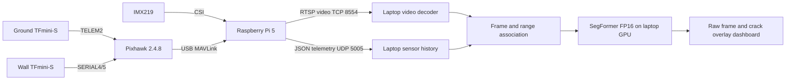

# CrackSense

Drone-assisted crack segmentation, from our initial CNN and U-Net experiments to a live SegFormer inspection pipeline.

We started with CNN classification and U-Net segmentation on an F450 drone project. The initial 1000 KV motor setup did not provide sufficient stability in our build, and model accuracy was unsatisfactory. **We did not test those models on a real drone feed.** We then trained and tested SegFormer B0, B1 and B2, upgraded to 920 KV DJI motors, integrated a Raspberry Pi 5, IMX219 camera and two TFmini-S lidars, and developed live laptop processing.

## Start here

| Goal | Reading and execution path |
|---|---|
| Understand the whole project | [History](docs/project-history.md) → phases 1–4 below |
| Build and test the onboard system | [Pi and hardware guide](02-raspberry-pi-and-hardware/README.md) → [live startup](04-live-implementation/docs/startup-sequence.md) |
| Train or inspect the models | [SegFormer](03-segformer/README.md) → [training](03-segformer/training/README.md) → [evaluation](03-segformer/evaluation/README.md) |
| Run live inference with a trained checkpoint | [Checkpoint requirements](03-segformer/checkpoints/README.md) → [live implementation](04-live-implementation/README.md) |
| Find what a particular file does | [Complete file index](docs/file-index.md) |

## Four project phases

1. [CNN and U-Net](01-cnn-unet/README.md): historical training notebooks, model code and offline web demo.
2. [Raspberry Pi and hardware](02-raspberry-pi-and-hardware/README.md): ordered camera, communication and lidar bring-up; separate navigation experiments.
3. [SegFormer](03-segformer/README.md): training notebooks, B0/B1/B2 walkthroughs, offline inference and model packaging.
4. [Live implementation](04-live-implementation/README.md): Pi video/telemetry transmission and laptop decoding, range association, inference and recording.

Folder numbers give a useful build order. The historical sequence was CNN/U-Net → transformer development → upgraded hardware integration → live implementation.

## Where the code runs

| Device | Responsibility | Code |
|---|---|---|
| Training computer | Train CNN/U-Net or SegFormer; evaluate and export models | Phases 1 and 3 |
| Pixhawk 2.4.8 | Flight control and both lidar interfaces | Configured through Mission Planner; no custom firmware supplied |
| Raspberry Pi 5 | IMX219 capture, MediaMTX stream, Pixhawk MAVLink reception, UDP sender | Phase 2 and `04-live-implementation/raspberry-pi/` |
| Ground-station laptop | Receive video and telemetry; run SegFormer on CUDA; display masks and ranges | `04-live-implementation/ground-station/` |

The Pi does not run the final live segmentation model. Lidar ranges annotate the results; they are not neural-network inputs or flight commands. [Detailed data flow](docs/system-data-flow.md).

## Results and status

Saved checkpoint outputs show validation Dice of 0.7711, 0.7827 and 0.7910 for B0, B1 and B2 respectively. These are **validation values**, not test accuracy. A saved FP16 benchmark measured 16.59 ms processing time; a later live session measured 23.75 ms mean processing time. Neither measures full camera-to-screen latency. See [results and limitations](docs/results-and-limitations.md) for the evidence and timing scopes.

The repository includes the available source, historical experiments and selected run summaries. Empty placeholders and incomplete prototypes are labelled in the file index. Datasets, model weights and large recordings are not included; [dataset access](03-segformer/datasets/README.md) and [checkpoint setup](03-segformer/checkpoints/README.md) explain the prerequisites.

## Reuse and contributions

Read [contribution and validation guidance](CONTRIBUTING.md) before changing execution paths. A code license has not yet been selected by the project owner; public availability does not itself grant an open-source license. Dataset and dependency terms are separate. Credentials and local environments are excluded from source control.
