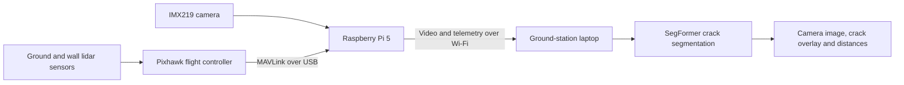

# CrackSense

### UAV-based crack detection using deep learning

CrackSense is a drone-assisted inspection prototype that combines aerial imaging, deep-learning segmentation and distance sensing to help identify visible cracks on structural surfaces. It was developed to support inspection of areas that are difficult to access and to present camera images with pixel-level crack predictions for human review.

The system uses an F450 quadcopter equipped with a Raspberry Pi 5, an IMX219 camera and two Benewake TFmini-S lidar sensors. During live operation, the Pi transmits video and flight-controller telemetry to a ground-station laptop. The laptop runs SegFormer and displays the original image, predicted crack mask and available distance measurements. The pilot controls the aircraft; model predictions support inspection and do not command flight.

[Getting started](docs/getting-started.md) · [System architecture](docs/system-data-flow.md) · [Hardware and wiring](docs/hardware-and-wiring.md) · [Results](docs/results-and-limitations.md)

## Prototype and testing

<table>
<tr>
<th width="50%">Assembled inspection drone</th>
<th width="50%">Handheld inspection test</th>
</tr>
<tr>
<td align="center"></td>
<td align="center"></td>
</tr>
<tr>
<td>Upgraded F450 platform with 920 KV motors and onboard sensing.</td>
<td>Camera-to-laptop processing checked with the aircraft held near the inspection surface.</td>
</tr>
</table>

## Live demonstration

<table>
<tr>
<th width="30%">Inspection during flight</th>
<th width="70%">Ground-station segmentation display</th>
</tr>
<tr>
<td align="center" valign="middle"></td>
<td align="center" valign="middle"></td>
</tr>
<tr>
<td>External view of the aircraft and laptop during a flight demonstration.</td>
<td>Original camera image on the left; predicted crack overlay on the right, with processing statistics and available lidar readings below.</td>
</tr>
</table>

These demonstrations show the integrated system in operation. Quantitative model results and timing measurements are documented separately in [results and limitations](docs/results-and-limitations.md). View the [photo gallery](docs/project-gallery.md) or [additional recordings](docs/flight-demonstrations.md) for more examples.

## How the system works

The Pi handles image capture and communication; the laptop performs segmentation. Lidar readings provide distance context alongside the image. They are not model inputs or validated crack-width measurements. The [detailed architecture](docs/system-data-flow.md) explains streaming, telemetry and frame association.

## Explore the repository

The repository is organised into four learning and implementation phases. Each phase has its own setup instructions and explains where its code runs.

| Phase | What you will learn | Execution environment |
|---|---|---|
| [1. CNN and U-Net](01-cnn-unet/README.md) | Initial classification and segmentation models, training notebooks and offline demonstration | Training or development computer |
| [2. Raspberry Pi and hardware](02-raspberry-pi-and-hardware/README.md) | Camera checks, calibration, MAVLink communication and dual-lidar testing | Raspberry Pi; Mission Planner on the laptop |
| [3. SegFormer](03-segformer/README.md) | Dataset preparation, training, model evaluation and deployment packaging | Training computer or GPU laptop |
| [4. Live implementation](04-live-implementation/README.md) | Video and telemetry transmission, laptop inference, dashboard and recording | Raspberry Pi and ground-station laptop |

**New to the project?** Follow the [getting-started guide](docs/getting-started.md). It explains the terminology, prerequisites and recommended sequence. Historical and experimental folders are optional reference material; they are not part of the default live setup.

## Project development

Development began with CNN classification and U-Net segmentation alongside an F450 aircraft using 1000 KV motors. Model performance and aircraft stability were insufficient for the intended demonstration, so these models were evaluated offline and were not tested on a live drone feed.

The project then progressed to SegFormer B0, B1 and B2 training and testing, followed by a 920 KV motor upgrade and integration of the Pi, camera and lidar sensors. Camera calibration, MAVLink communication and subsystem tests preceded live laptop processing. See the [development history](docs/project-history.md) for the complete sequence. Folder numbering follows the recommended learning order rather than the exact chronology.

## Models, data and results

SegFormer predicts a binary crack mask: each pixel is classified as crack or background. Training used image–mask pairs from CrackSeg9k and CrackVision12K; the [dataset guide](03-segformer/datasets/README.md) explains access and preparation.

| Model | Recorded validation Dice |
|---|---:|
| SegFormer B0 | 0.7711 |
| SegFormer B1 | 0.7827 |
| SegFormer B2 | 0.7910 |

Dice measures overlap between predicted and reference masks. These values come from saved checkpoint validation records and are not test accuracy. B2 was carried forward into deployment experiments, with FP16 inference on the laptop GPU. See [evaluation and performance details](docs/results-and-limitations.md) for measurement conditions and remaining limitations.

Datasets and trained weights are not bundled. To reproduce inference, provide a compatible model using the [checkpoint guide](03-segformer/checkpoints/README.md). The system remains a research prototype: thin cracks, surface texture and image conditions can affect predictions, and structural assessment remains the responsibility of a qualified inspector.

## Further documentation

- [Hardware connections and component configuration](docs/hardware-and-wiring.md)
- [Step-by-step live startup](04-live-implementation/docs/startup-sequence.md)
- [Troubleshooting](04-live-implementation/docs/troubleshooting.md)
- [Code reference by execution environment](docs/file-index.md)
- [Contribution and validation guidance](CONTRIBUTING.md)

A repository license has not yet been selected. Contact the project owner about reuse; datasets and dependencies retain their respective terms.
