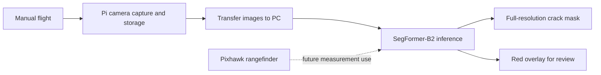

# CrackSense

CrackSense is a UAV-assisted structural inspection prototype that segments visible cracks in concrete and masonry images. A manually piloted quadcopter captures close-range images; a SegFormer model processes the images on a PC and returns pixel-level crack masks for review.

The project keeps image analysis separate from flight control. Crack predictions do not control the aircraft. ArUco-guided flight, optical-flow/VIO navigation, and onboard crack inference are future scope.

## Project at a glance

- **Inspection platform:** F450 quadcopter, Pixhawk flight controller, Raspberry Pi 5, and IMX219 camera.
- **Vision task:** binary semantic segmentation (`background`, `crack`) with SegFormer MiT-B2.
- **Input processing:** RGB conversion, resize to 256 × 256, and ImageNet normalization.
- **Outputs:** binary crack masks and red overlays restored to the input frame dimensions.
- **Inference modes:** sampled video processing, optional test-time augmentation, and experimental FP32/FP16/dynamic INT8 packaging.

## Reported model results

The final project report records the following held-out test results for SegFormer-B2 at threshold `0.800`:

| Test set | Dice | IoU | Precision | Recall |
|---|---:|---:|---:|---:|
| 3,461 images | 0.7968 | 0.6623 | 0.7823 | 0.8119 |

These are the results reported by the project team, not results reproduced from this repository checkout. The dataset and trained checkpoints are not included. The report also notes a possible duplication of 11,298 CrackSeg9K pairs that has not been hash-checked, no quantitative evaluation on drone images, and a non-controlled comparison of model variants. See [model and results notes](docs/model-and-results.md) before interpreting or reusing these metrics.

## System overview



The Black Book also records a later live laptop-processing prototype that received RTSP video and MAVLink telemetry and visually ran segmentation on camera images. It does not establish synchronized range-to-frame association, camera-to-screen latency, or autonomous operation.

## Repository contents

| File | Purpose |
|---|---|
| `Crack_Detector_main.py` | Main sampled-video inference script; saves overlays and binary masks |
| `crack_video_inference.py` | Earlier video inference path with calibrated or Otsu threshold selection |
| `CrackSense_Explained_B2.ipynb` | SegFormer-B2 pipeline walkthrough |
| `CrackSense_Explained_B2_OriginalResolutionMasks.ipynb` | Original-resolution mask and TTA walkthrough |
| `quantize_segformer.py` | Exports FP32, FP16, and dynamic INT8 inference checkpoints |
| `Verify_quantised.py` | Inspects and smoke-checks packaged checkpoints |
| `compare_videos.py` | FP32/FP16/INT8 comparison script; requires a CUDA-capable GPU |
| `drone_pipeline_PI.py` | Experimental file-watcher daemon; its referenced inference script and INT8 checkpoint are not included here |
| `PROJECT_ARCHITECTURE_REPORT.md` | Source-based architecture and workflow report |
| `docs/` | Project history, architecture, model results, inference, troubleshooting, and future scope |
| `context.md` | Compact maintainer context for future work |

## Quick start

### 1. Prepare a compatible Python environment

Use a Python environment compatible with the checkpoint that you have. Install a PyTorch build that matches your operating system and CUDA setup, then install the other runtime packages:

```bash
python -m venv .venv
```

Activate the environment, then install the PyTorch build for your machine and the project dependencies:

```bash
python -m pip install transformers opencv-python numpy albumentations
```

This repository does not currently include a pinned `requirements.txt` or a version lockfile. Full-model PyTorch checkpoints can depend on the PyTorch and Transformers versions used when they were saved, so use the original working environment where possible.

### 2. Add a trusted model checkpoint and a video

The inference scripts and model weights are separate. Place a trusted checkpoint in one of the locations searched by the script, or pass its path explicitly. The default search order for `Crack_Detector_main.py` is:

1. `Quantised/latest_fp32.pt`
2. `Quantised/latest_fp16.pt`
3. `Quantised/latest_int8.pt`
4. `checkpoints/latest.pt`
5. `checkpoints/best.pt`

The repository does not include model weights, training data, or sample videos. Only load checkpoints from a trusted source: packaged full-model checkpoints use Python deserialization.

### 3. Run video inference

From the repository root:

```bash
python Crack_Detector_main.py --video path/to/inspection.mp4 --checkpoint path/to/model.pt --fps 2
```

To process a fixed number of evenly spaced frames instead of using `--fps`:

```bash
python Crack_Detector_main.py --video path/to/inspection.mp4 --checkpoint path/to/model.pt --num-frames 100
```

Useful options include `--start`, `--end`, `--max-frames`, `--output`, and `--tta`. TTA runs five model passes per frame and is slower. See the command help for the full option list:

```bash
python Crack_Detector_main.py --help
```

The main script applies Otsu thresholding separately to each processed frame. Results are written to numbered folders under `output/`, with an overlay image and binary mask for each selected frame.

## Model pipeline

1. Read a video frame with OpenCV and convert BGR to RGB.
2. Resize it to 256 × 256 and apply ImageNet channel normalization.
3. Run the two-class SegFormer model.
4. Compute the crack score from the crack and background logits, then apply a threshold.
5. Resize the binary mask to the original frame dimensions with nearest-neighbor interpolation.
6. Save the mask and a red blended overlay.

Threshold choice affects the precision/recall balance. The main `Crack_Detector_main.py` path uses per-frame Otsu thresholding. The earlier `crack_video_inference.py` path supports either a fixed calibrated threshold or Otsu. Do not compare their outputs as if they used the same threshold procedure.

## Documentation

- [Project history and phases](docs/project-history.md)
- [System architecture](docs/system-architecture.md)
- [Model, dataset, and results](docs/model-and-results.md)
- [Inference and model packaging](docs/inference.md)
- [Hardware and troubleshooting](docs/hardware-and-troubleshooting.md)
- [Future scope](docs/future-scope.md)

## Current status and limitations

- The demonstrated flight workflow is manual; the model has no flight-control authority.
- The main reported test metrics use public datasets. Drone-camera evaluation in the report is visual and has no ground-truth masks.
- Inference downsamples images to 256 × 256, which can lose thin cracks.
- The dataset may contain duplicate pairs; the report says a hash-based check is pending.
- The report identifies threshold metadata inconsistencies and says experimental TTA scaling, severity estimation, and quantized packages require further evaluation.
- The repo does not contain the dataset, checkpoints, a pinned environment, or the full Pi/Phase 4 implementation.

## Data and safety notes

Dataset and image licenses must be checked before redistribution. Do not commit Kaggle credentials, private keys, or other secrets. Inspection predictions are a review aid and are not a structural safety assessment. Any future flight-control work requires separate staged validation and a manual pilot takeover path.
