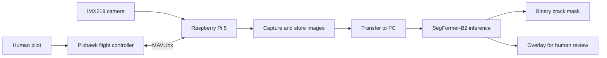

> Historical document: superseded by the [current repository guide](../../../README.md). Paths, status and claims below may be outdated.

# System Architecture

## Completed baseline

The system has three main responsibilities:

| Component | Responsibility |
|---|---|
| Pixhawk flight controller | Stabilizes the manually piloted F450 platform and provides the MAVLink interface |
| Raspberry Pi 5 and camera | Captures and stores close-range structural images; provides a local camera preview/stream |
| PC or laptop | Runs SegFormer inference and displays/saves crack masks and overlays |

The image-analysis stage does not send commands to the flight controller. The rangefinder is used for subsystem verification in the report and is not used by the current crack-segmentation pipeline.

## Later live-processing prototype

Later implementation notes describe camera video streamed over RTSP to laptop inference, with MAVLink telemetry received separately. The Black Book records video and telemetry reception and visual segmentation on camera frames. It marks synchronized range-to-frame matching, recording, and end-to-end in-flight timing as needing validation.

Processing time is not camera-to-screen latency. Message-time association is approximate until validated against an independent timing reference and verified sensor acquisition timestamps.

## Future architecture

The planned ArUco demonstration would estimate marker displacement from the camera and send carefully limited commands through MAVLink in Guided mode, with manual takeover. The report requires camera-frame to vehicle/local-frame conversion and staged safety checks. Optical-flow/VIO and onboard crack inference are later extensions; neither should be represented as current functionality.
