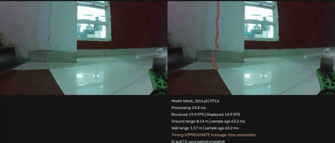
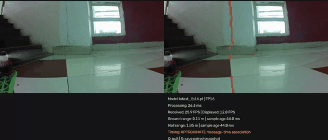

# Live inspection demonstrations

These recordings show camera-to-laptop segmentation during project testing. The dashboard presents the original camera frame on the left and the predicted crack overlay on the right, with processing statistics and available lidar readings below.

## Ground-station segmentation display

<table>
<tr><th width="50%" align="center">Raw</th><th width="50%" align="center">Processed</th></tr>
<tr><td colspan="2"></td></tr>
</table>

The ground-station laptop receives the camera stream and sensor data, runs SegFormer, and displays the inspection results.

## Additional dashboard recording

<table>
<tr><th width="50%" align="center">Raw</th><th width="50%" align="center">Processed</th></tr>
<tr><td colspan="2"></td></tr>
</table>

A second recording illustrates the dashboard output as the camera view changes.

## Inspection during flight

The aircraft operates near the inspection surface while the laptop displays the streamed images and segmentation results.

The recordings demonstrate operation rather than measured accuracy. Frame-to-sensor association is approximate, and unavailable sensor readings remain marked as unavailable. See [results and limitations](results-and-limitations.md) for quantitative evidence. Web animations retain the full clip duration, with reduced frame rate and colour palette to improve loading.

[Live setup](../04-live-implementation/README.md) · [Photo gallery](project-gallery.md) · [Project overview](../README.md)
