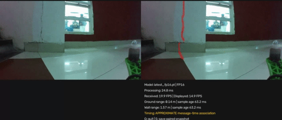
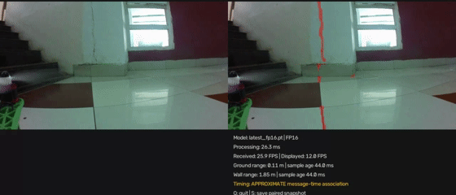
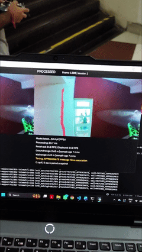

# Animated flight demonstrations

These original project GIFs document the live demonstration. They are kept on this separate page because each is approximately 12 MB. The main README uses still photographs.

The paired dashboard shows the raw frame at left, red predicted mask at right, and processing/range diagnostics below. These clips are qualitative evidence of operation, not a ground-truth accuracy benchmark or a full camera-to-screen timing measurement. The display labels its association as approximate message-time matching.

[Live implementation and startup](../04-live-implementation/README.md) · [Photo gallery](project-gallery.md)

## Dashboard recording 1

The camera viewpoint moves along the wall while the predicted red overlay and range information update.

## Dashboard recording 2

A second project recording of the paired raw and processed display. Source filename: `Fight_test2.gif`.

## Aircraft and laptop together

This external view shows the aircraft in flight and the laptop display together. Some moments show unavailable sensor diagnostics; the recording preserves the actual displayed behaviour.
