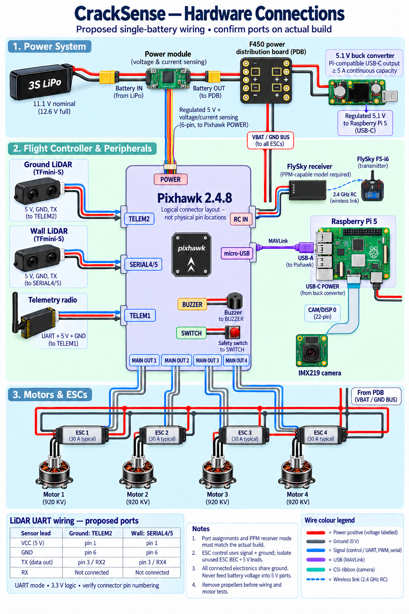

# Hardware and wiring

The project owner confirmed this wiring diagram as the reference for the upgraded build.

| Item | Initial build | Upgraded build |
|---|---|---|
| Frame | F450 | F450 |
| Motors | 1000 KV | 920 KV DJI; team reports 500 g+ thrust per motor |
| ESCs | 40 A | Diagram labels 30 A typical |
| Controller and radio | Pixhawk 2.4.8; FlySky FS-i6 setup | Same project platform |
| Camera and companion computer | No live model feed tested | IMX219 and Raspberry Pi 5 |
| Ground lidar | — | TFmini-S → TELEM2 |
| Wall lidar | — | TFmini-S → SERIAL4/5 |
| Pi–Pixhawk link | — | USB-A on Pi → micro-USB on Pixhawk; MAVLink |

The diagram shows 3S LiPo → power module → F450 distribution board; ESC power comes from the board. Pixhawk receives its power-module connection. A 5.1 V buck converter supplies Pi USB-C. Camera CSI ribbon connects IMX219 to the Pi. These are project-level connections, not a substitute for confirming actual connector pin numbering and installed hardware.

The older data-flow PNG reversed the two lidar port labels. It is not published as an authoritative diagram here; the [Mermaid flow](system-data-flow.md) uses the confirmed assignments. MAVLink sensor ID 0/1 is not a serial-port number. The live defaults are wall ID 0/orientation 0 and ground ID 1/orientation 25; verify by moving targets independently.

Mission Planner was used for configuration and tuning. An exported, verified flight-controller parameter file is not included, so this repository does not prescribe a universal parameter set for another aircraft.
