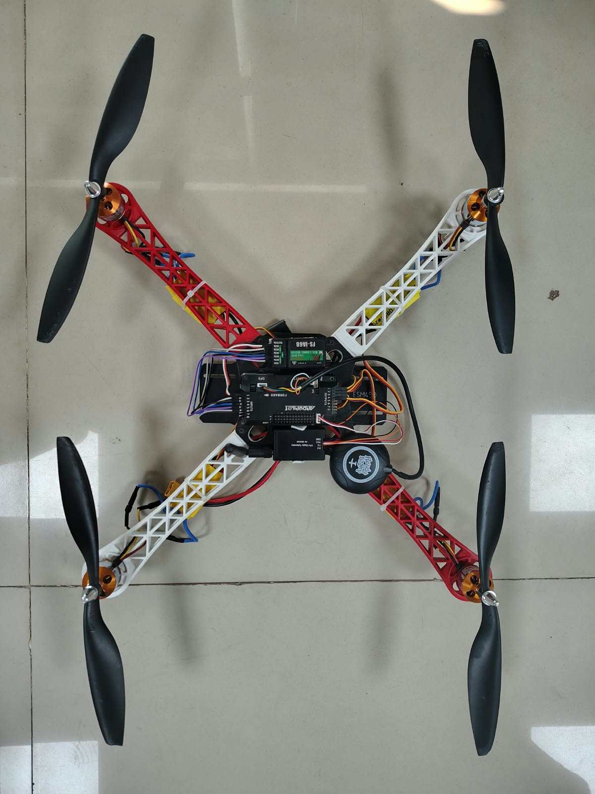
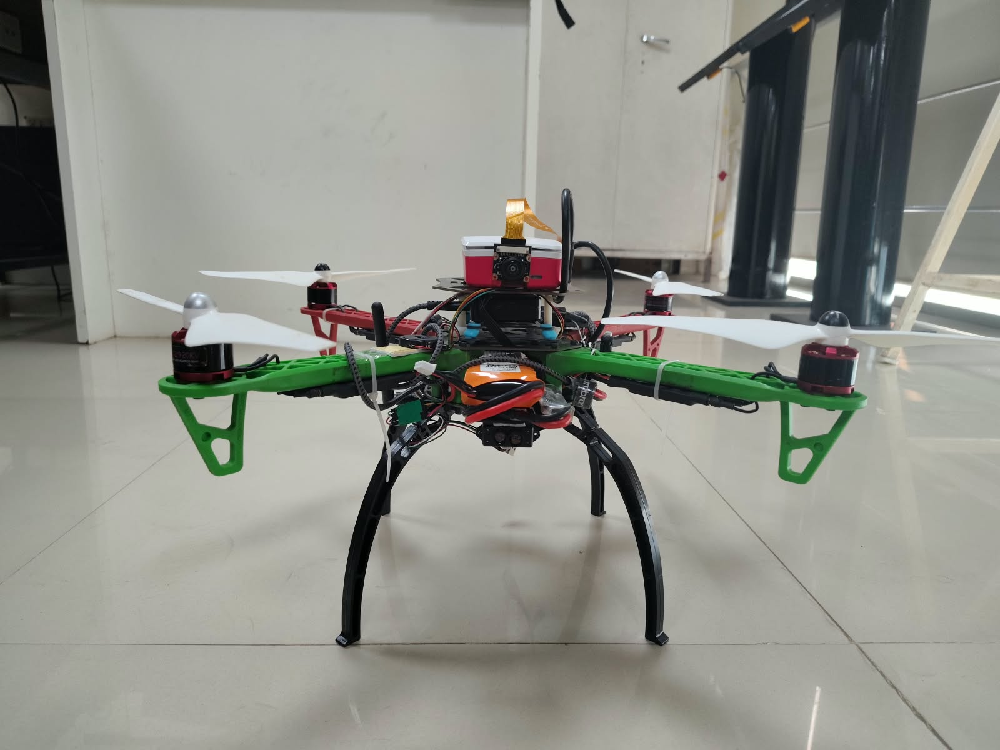
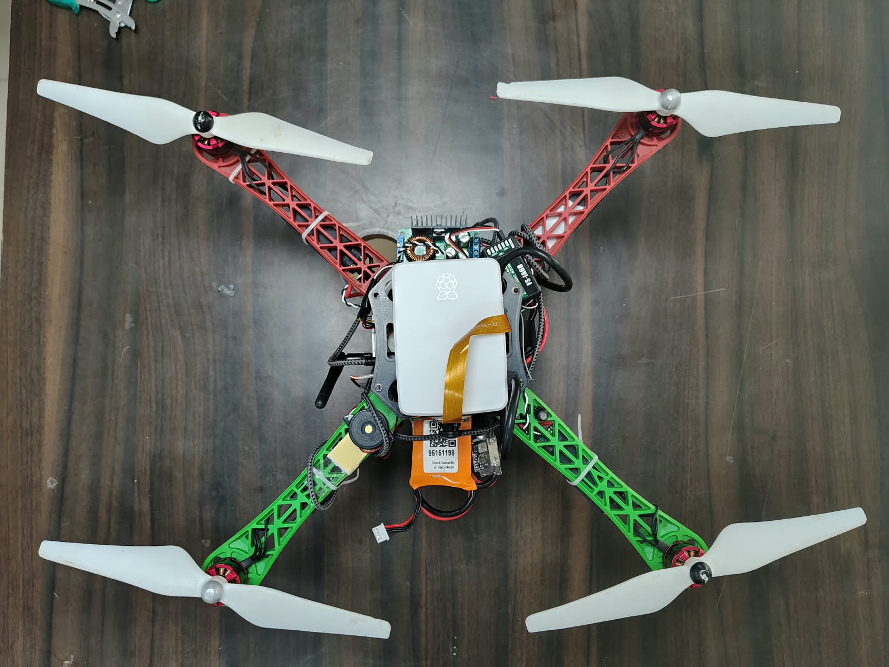
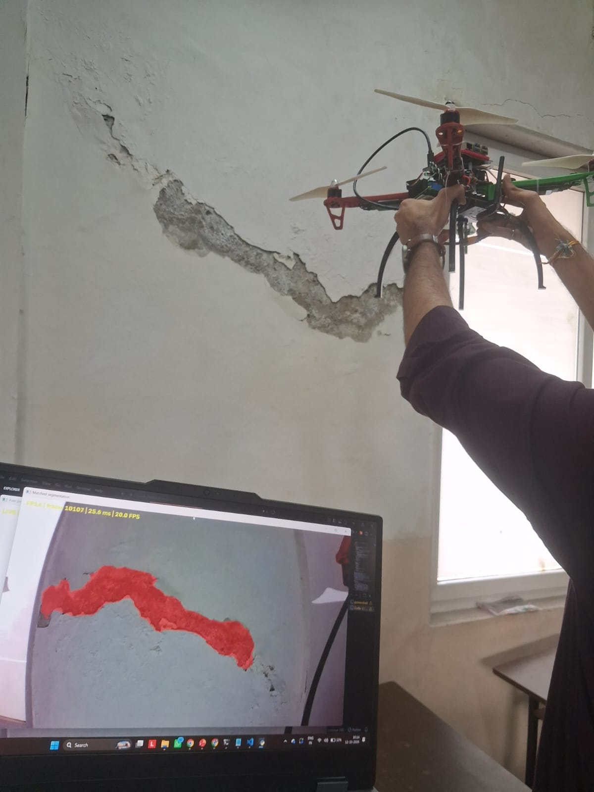
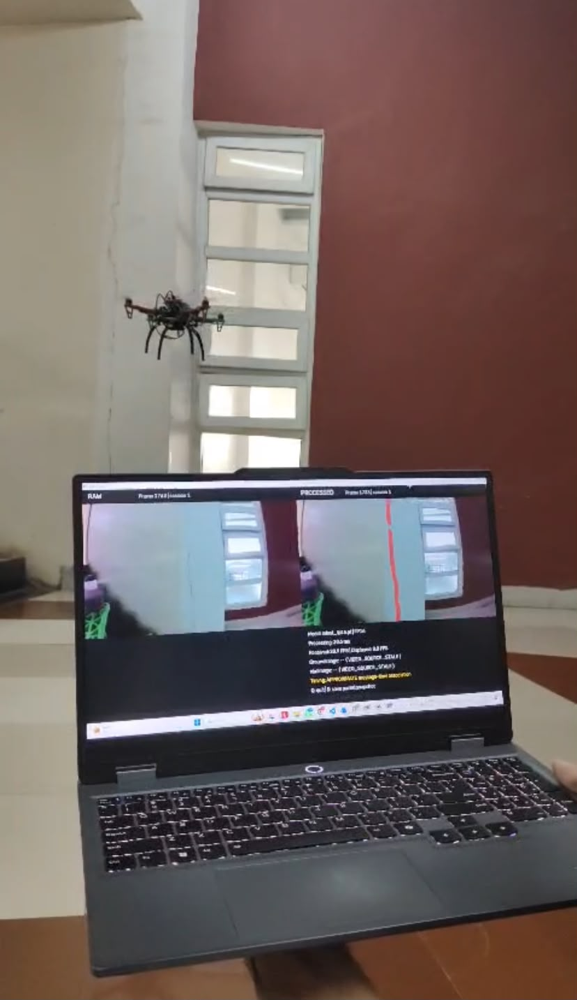
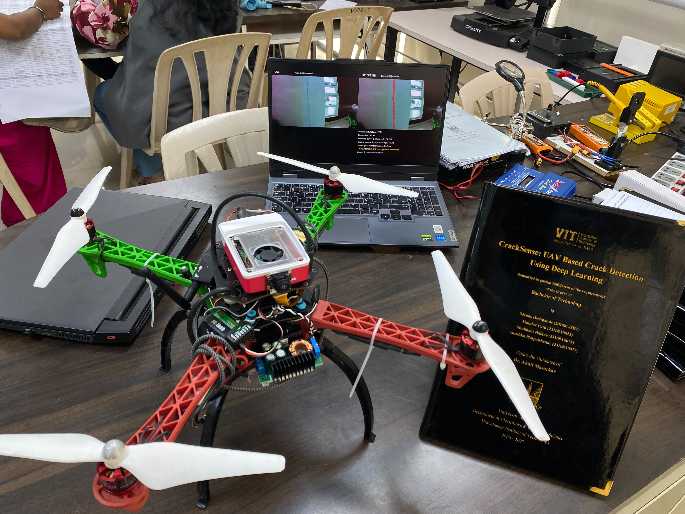
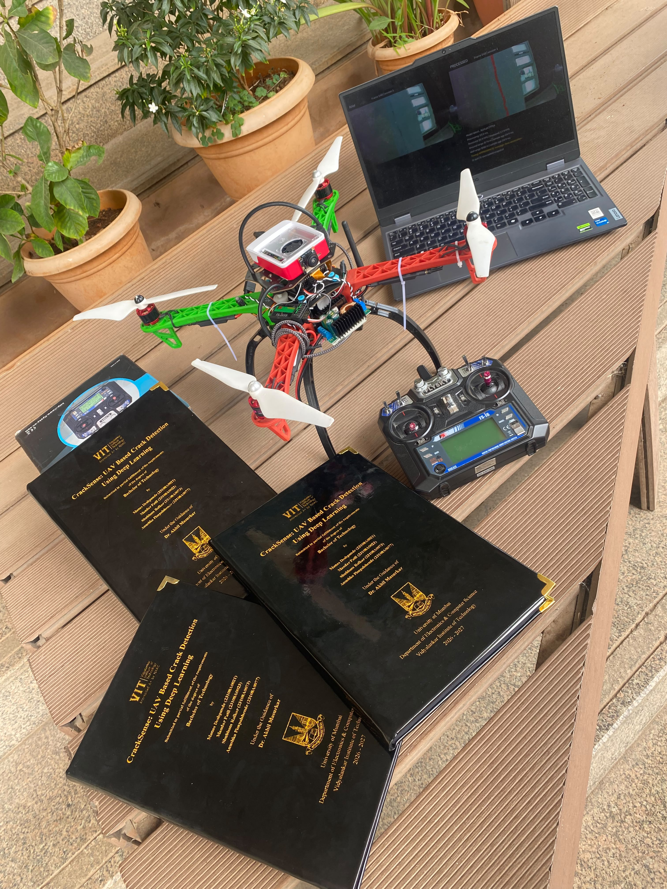
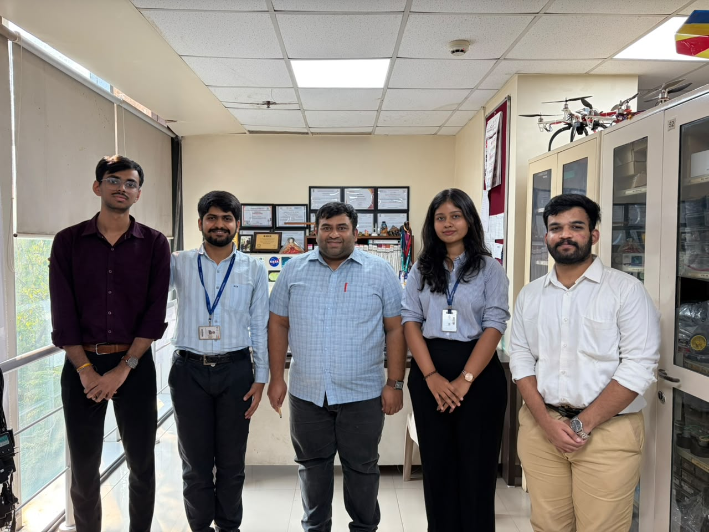

# Project photo gallery

Photographs from the project’s development, testing and presentation. Captions describe visible content and the supplied project context. The original files are preserved without image edits; descriptive repository filenames and source hashes are recorded in [the image manifest](images/project/manifest.json).

[Main project guide](../README.md) · [Animated demonstrations](flight-demonstrations.md)

## Initial aircraft

The earlier aircraft build. CNN/U-Net work remained offline; no real drone-feed model test was performed in that stage.

## Upgraded aircraft front view

The integrated 920 KV build with camera mounting and landing gear.

## Upgraded aircraft top view

Pi enclosure, ribbon cable and onboard electronics viewed from above.

## Handheld testing

The camera is positioned manually near the wall while a laptop displays a red predicted region. This is a qualitative test of the camera-to-model path.

## Handheld testing close view

A closer view of the same type of test. The broad highlighted surface damage should not be interpreted as a validated crack-width measurement.

## Flight and ground station

The aircraft is airborne near the wall while the laptop displays raw and processed views.

## Live testing during flight

Another view of airborne testing and the laptop display. Sensor availability can change during a run; the photo is not a timing validation.

## Lab project presentation

The aircraft, ground-station display and project report presented together.

## Project and Black Books

Project hardware, radio transmitter, laptop and bound reports.

## Team and guide

The project team with their guide.
