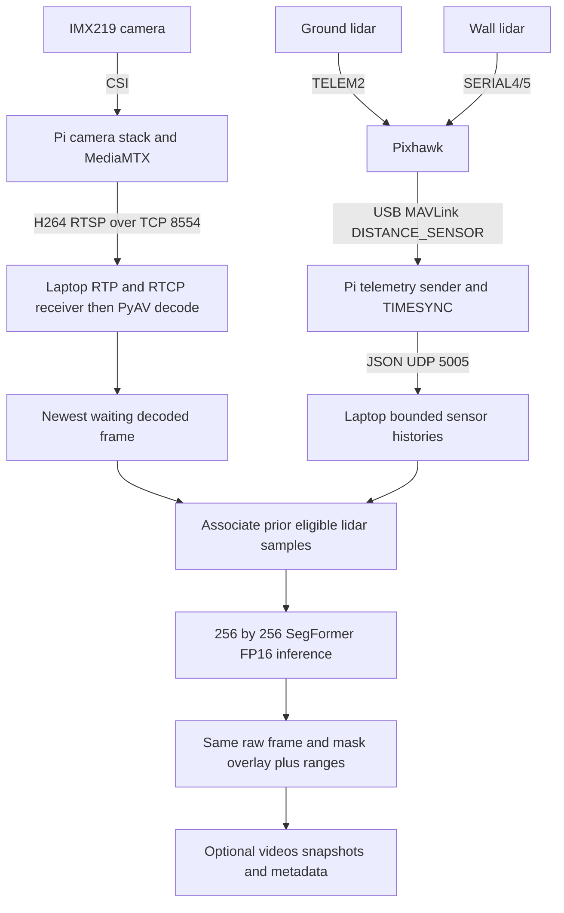

# Live system data flow

The saved camera configuration is 1280×720 at 25 FPS, software H.264 at a target 4 Mbps, with an IDR interval of 25. MediaMTX directly owns camera capture in this implementation. No separate FFmpeg publisher is required by this configuration.

The receiver retains RTP timing and uses RTCP sender reports for source-time mapping. PyAV decodes H.264; OpenCV handles images and the UI. Pi MAVLink TIMESYNC estimates map Pixhawk message times into the Pi timeline. The application then associates a frame with the newest eligible earlier sample per sensor.

Inference converts BGR to RGB, resizes to 256×256, uses ImageNet normalization and evaluates a two-class model. It upsamples logits, applies sigmoid(crack logit minus background logit), thresholds, then resizes the binary mask using nearest-neighbour interpolation. The output is an overlay on the same frame used for inference.

Ranges are beam distances, not a depth map, automatically corrected altitude or validated crack dimensions. Missing timing/ranges remain unavailable. Skipping waiting frames limits application backlog but does not remove encoder/network delays. See [timing details](../04-live-implementation/docs/timing-and-sensor-association.md).
